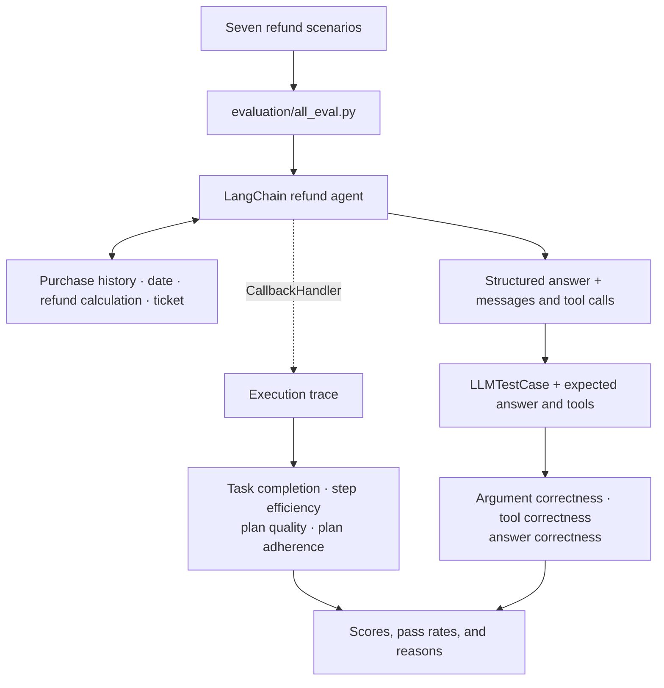

# LangChain AI Agent Evaluation System

> Build a refund support agent, trace its tool calls, and evaluate both its answers and its behavior with seven DeepEval metrics.


 OR 


A correct final answer is only one part of a successful agent run. Did the agent identify the customer, check refund eligibility, select the right tools, and refund only the requested items?

This repository is a hands-on learning lab for answering those questions. It pairs a LangChain refund agent with **seven evaluation scenarios**, **seven metrics**, and small examples that isolate individual evaluation concepts. Start with the examples, follow the complete evaluation flow, then adapt it to your own agent.


## Things which i learn

- Build a tool-using agent with a system prompt, conversation memory, and a structured response.
- Define evaluation cases with inputs, expected answers, and expected tools.
- Capture LangChain execution traces with DeepEval's `CallbackHandler`.
- Evaluate task completion, efficiency, planning, tool selection, tool arguments, and answer correctness.
- Use per-case explanations to decide whether to improve the agent, the dataset, or the evaluation itself.

The repository has two learning tracks:

| Track | Start here | Focus |
|---|---|---|
| Metric fundamentals | [`evaluation/`](evaluation/) | Small multiplication agents that demonstrate each metric with minimal business logic |
| Refund agent evaluation | [`evaluation/tool_correctness.py`](evaluation/tool_correctness.py) | A complete evaluation flow over customer support scenarios |

## How the agent works

The agent handles refund requests against the sample purchase records in [`agent/data.py`](agent/data.py). Its [system prompt](agent/prompts.py) requires it to identify the customer, check that purchases are no more than 30 days old and are not in the future, and refund only the items requested.

| Tool | Purpose |
|---|---|
| `get_user_purchase_history` | Look up a customer's purchases by username |
| `get_today_date` | Read the current date for eligibility checks |
| `calculate_right_refund` | Add the prices of the requested items |
| `issue_refund_ticket` | Return a simulated ticket confirmation for the refund amount |

The tools use in-memory sample data. Issuing a ticket returns a string; it does not contact a payment provider or create an external ticket. Eligibility checks are directed by the prompt rather than enforced inside the refund tools.

[`agent/agent.py`](agent/agent.py) creates the agent with an `InMemorySaver` checkpointer and the Pydantic [`Answer`](agent/objects.py) schema:

```python
class Answer(BaseModel):
    answer:str = Field(description="the answer that is needed for the user question")
    conversation:bool = Field(description="This is an indicator to know if the conversation" \
    "should still continue or no. if the agent has made the decision about the refund this should be False" \
    "if the conversation still need more talk then it's True", default=True)
```

`answer` contains the user-facing reply. `conversation` indicates whether the agent needs another user response. Evaluation cases each receive a new thread ID to keep their conversation histories separate.



## Quick start

You need **Python 3.12+**, **uv**, and an **Gemini API key / Groq API key** with access to the models configured in the code.

### 1. Get the project

```bash
git clone https://github.com/manish-msicode/Eval-Evaluation-Agent.git
cd LangChain_Agent_Evaluation_System
uv sync --locked
```

### 2. Configure your API key

Copy [`.env.example`](.env.example) to `.env` in the repository root, then set:

```dotenv
GEMINI_API_KEY = your_gemini_api_key_here OR GROQ_API_KEY = your_groq_api_key_here
```

The `.env` file is ignored by Git. Keep your real key there.

The refund agent and its evaluator currently both use the model identifier `gemini-3.5-flash-lite`. Check these two configuration files before running:

| Role | Configuration |
|---|---|
| Refund agent | [`agent/models.py`](agent/models.py) |
| DeepEval judge | [`evaluation/model.py`](evaluation/model.py) |

If that identifier is unavailable to your account, change each file to a model supported by its respective library and your API account. The standalone multiplication examples specify their own models inside their scripts.

### 3. Run the complete evaluation

Run commands from the repository root:

```bash
uv run --env-file .env python evaluation/all_eval.py
```

This runs the refund agent once per scenario, evaluates all seven metrics, and prints reports in the terminal. Agent generation and LLM-based judging make API calls and incur usage costs.

> **Check the dates before interpreting scores.** The purchase records use fixed dates, while `get_today_date` reads your machine's current date. The expected answers are static. Align the sample dates and expected outcomes for your experiment; see [Evaluation dataset](#dataset.py).

## Run evaluations

### All seven metrics

[`evaluation/all_eval.py`](evaluation/all_eval.py) is the main entry point. It performs evaluation in two stages:

1. `dataset.evals_iterator(...)` runs four metrics against the execution trace captured by `CallbackHandler`.
2. The runner collects the same run's structured answer and tool calls into an `LLMTestCase`. `evaluate(...)` then applies the remaining three metrics.

Reusing the response avoids generating a different answer for each metric. The runner disables cache reads and writes and sets `inspect_after_run=False`, so it does not automatically launch the inspector. The terminal ends with:

```text
Completed all 7 metrics for 7 test cases.
```

Completion means the evaluation finished; individual metrics can still fail. The script produces two evaluation reports, one for each stage, rather than a single combined export.

### Study one metric at a time

For small examples without the refund workflow:

```bash
uv run --env-file .env python evaluation/tool_correctness.py
uv run --env-file .env python evaluation/argument_correction.py
uv run --env-file .env python evaluation/step_efficiency.py
```

For an individual metric applied to the refund agent:

```bash
uv run --env-file .env python evaluation/task_completion.py
uv run --env-file .env python evaluation/tool_correctness.py
uv run --env-file .env python evaluation/answer_correctness.py
```

Each individual script invokes the agent again. Its configuration can differ from the combined runner. In particular, `evaluation/argument_correction.py` collects tool calls but omits them from its `LLMTestCase`; use the combined runner for refund argument evaluation.

## Evaluation metrics

These thresholds are defined in `build_metrics()` in [`evaluation/all_eval.py`](evaluation/all_eval.py). Scores run from 0 to 1; a score at or above the threshold passes.

| Metric | DeepEval implementation | What it checks | Evidence | Threshold |
|---|---|---|---|---:|
| Task completion | `TaskCompletionMetric` | Whether the agent achieved the task under the stated refund rules | Execution trace + task description | 0.80 |
| Step efficiency | `StepEfficiencyMetric` | Whether the agent took unnecessary or redundant steps | Execution trace | 0.80 |
| Plan quality | `PlanQualityMetric` | Whether the agent's plan is suitable for the task | Execution trace | 0.80 |
| Plan adherence | `PlanAdherenceMetric` | Whether execution follows the agent's plan | Execution trace | 0.80 |
| Argument correctness | `ArgumentCorrectnessMetric` | Whether tool inputs are appropriate for the request | User input + actual tool calls and arguments | 0.90 |
| Tool correctness | `ToolCorrectnessMetric` | Whether the agent called the expected tools | Actual tool calls + expected tools | 0.90 |
| Answer correctness | `GEval` | Whether the answer reaches the expected logical conclusion | Input + actual answer + expected answer | 0.80 |

The refund dataset specifies expected **tool names**, without reference arguments. The combined runner also leaves exact matching and tool ordering at their defaults. Its tool correctness score therefore does not establish that arguments or execution order were correct. Inspect those separately.

The `GEval` rubric checks the logical conclusion against the reference answer. Read the reasons alongside the score to see whether details such as the refund amount were assessed as intended.

## Evaluation dataset

[`evaluation/dataset.py`](evaluation/dataset.py) defines seven DeepEval `Golden` cases. A golden describes the desired behavior before the agent runs; an `LLMTestCase` adds the actual output and observed tool calls afterward.

| Scenario | Expected behavior encoded in the dataset |
|---|---|
| `user123`: refund book and pen | Issue a $30 refund ticket |
| `user123`: refund book | Issue a $23 ticket |
| `user123`: inquiry only (no refund) | Provide purchase list without issuing a ticket |
| Missing / invalid username | Request a valid username |
| `user126`: refund water bottle | Deny refund due to exceeding 30-day limit |
| `user126`: refund backpack and water bottle | Issue $45 ticket for backpack; deny water bottle |
| `user126`: request unpurchased sneakers | Deny refund because item was not purchased |

**These expected outcomes need a consistent date reference.** Most sample purchases are dated October 2026. For example, on October 15, 2026, the October 22 book purchase is in the future, while its reference answer calls it more than 30 days old. A correct policy decision can therefore disagree with the reference answer.

For a meaningful experiment, align [`agent/data.py`](agent/data.py) and the expected answers with the date you intend to test. For repeatable experiments, adapt the date tool to return a fixed reference date and record it with your results.

## Read the results

The screenshots below show an example run over seven cases. They illustrate how to diagnose failures; they are not a reproducible benchmark or a guarantee of current performance.

| Metric | Average score | Pass rate | Passed / total |
|---|---:|---:|---:|
| Task completion | 0.83 | 71.43% | 5 / 7 |
| Step efficiency | 1.00 | 100.00% | 7 / 7 |
| Plan quality | 0.68 | 42.86% | 3 / 7 |
| Plan adherence | 0.93 | 85.71% | 6 / 7 |
| Argument correctness | 0.79 | N/A | 0 / 0 |
| Tool correctness | 0.95 | 57.14% | 4 / 7 |
| Answer correctness | 1.00 | 100.00% | 7 / 7 |


Average score and pass rate answer different questions. Argument correctness averages 0.79, but only two cases meet its 0.90 threshold. High step efficiency also does not establish that the agent made a good plan: inspect the plan quality failures and their traces together.

(C:\Users\n9571\OneDrive\Pictures\Screenshots\Screenshot 2026-10-26 191806.png)(C:\Users\n9571\OneDrive\Pictures\Screenshots\Screenshot 2026-10-26 191820.png)

In this case, the agent reports that the customer could not be found. Tool correctness and answer correctness pass, while argument correctness fails. Read the captured arguments and the judge's reason before changing the agent: the failure may expose an agent mistake, missing evaluation evidence, or a rubric that needs refinement.

LLM judgments and agent responses can vary between runs. Keep the model choices, date reference, prompts, dataset, and thresholds with any results you compare.

## Explore and extend

A suggested reading order:

1. Read [`evaluation/tool_correctness.py`](evaluation/tool_correctness.py) to see inputs, expected tools, actual tool calls, and scoring in one small example.
2. Explore [`agent/prompts.py`](agent/prompts.py), [`agent/tools.py`](agent/tools.py), and [`agent/agent.py`](agent/agent.py) to understand the refund workflow.
3. Read [`evaluation/dataset.py`](evaluation/dataset.py) to connect each business rule to an expected outcome.
4. Follow [`evaluation/all_eval.py`](evaluation/all_eval.py) from trace capture to test case construction and scoring.
5. Inspect a failed case, change one part of the system, and rerun with the same evaluation settings.

To evaluate your own agent, replace the sample data and tools, rewrite the system prompt, and define goldens for your task. Update `SUCCESSFUL_TASK_DESCRIPTION` and the `GEval` rubric in the combined runner so the judges assess your intended behavior.

Useful additions to the dataset include purchases exactly 30 days old, future purchases, mixed eligible and ineligible items, duplicate item requests, and attempts to bypass the refund policy. Add expected tool arguments when you want stronger reference checks, and enable order or exact-match checks only when those requirements are part of your task.

## Project map

| Path | Purpose |
|---|---|
| [`agent/agent.py`](agent/agent.py) | Four-tool agent, memory, structured response, and interactive conversation helper |
| [`agent/tools.py`](agent/tools.py) | Purchase lookup, date lookup, refund calculation, and simulated ticket tools |
| [`agent/data.py`](agent/data.py) | Sample purchases for ten customers |
| [`agent/prompts.py`](agent/prompts.py) | Refund policy and conversation instructions |
| [`agent/objects.py`](agent/objects.py) | `Answer` and `PurchaseItem` Pydantic schemas |
| [`agent/models.py`](agent/models.py) | Agent model configuration |
| [`evaluation/dataset.py`](evaluation/dataset.py) | Seven refund goldens with expected answers and tools |
| [`evaluation/all_eval.py`](evaluation/all_eval.py) | Combined seven-metric evaluation runner |
| [`evaluation/model.py`](evaluation/model.py) | Judge model configuration |
| [`evaluation/argument_correction.py`](evaluation/argument_correction.py) | Evaluates tool arguments correctness |
| [`evaluation/answer_correctness.py`](evaluation/answer_correctness.py) | Evaluates final answer semantic alignment |
| [`evaluation/step_efficiency.py`](evaluation/step_efficiency.py) | Evaluates redundant steps during execution |
| [`evaluation/task_completion.py`](evaluation/task_completion.py) | Evaluates end-to-end task goal completion |
| [`evaluation/plan_quality.py`](evaluation/plan_quality.py) | Evaluates generated step plans |
| [`evaluation/plan_adherence.py`](evaluation/plan_adherence.py) | Evaluates execution alignment with plans |
| [`evaluation/tool_correctness.py`](evaluation/tool_correctness.py) | Evaluates tool selection and invocation |
| [`pyproject.toml`](pyproject.toml), [`uv.lock`](uv.lock) | Project dependencies and locked environment |
| [`.env.example`](.env.example) | API key template |

## Limitations and troubleshooting

This is an educational prototype with a small, single-turn evaluation dataset. The interactive agent has memory, but the seven goldens do not test complete multi-turn conversations. Refund eligibility is prompt-driven, and the tools do not provide production validation or persistent storage. Unknown users or items passed directly to the calculation tool can raise lookup errors.

| Symptom | What to check |
|---|---|
| Authentication or model access error | Set `GEMINI_API_KEY` in the root `.env` and verify both model configurations |
| Unexpected date-related failures | Align purchase dates, today's date, and the expected answers |
| `No module named streamlit` | Use the demo command with `--with streamlit` |
| Import errors when launching scripts | Run the documented file commands from the repository root; the scripts use local imports |
| Argument correctness has missing evidence | Use `evaluation/all_eval.py`, which passes `tools_called` into each test case |
| Different scores on a rerun | Compare model settings, dates, traces, and judge reasons before drawing conclusions |

Start with the documented Python script commands. The package entry point declared in `pyproject.toml` points to a `main` function that is not currently implemented.